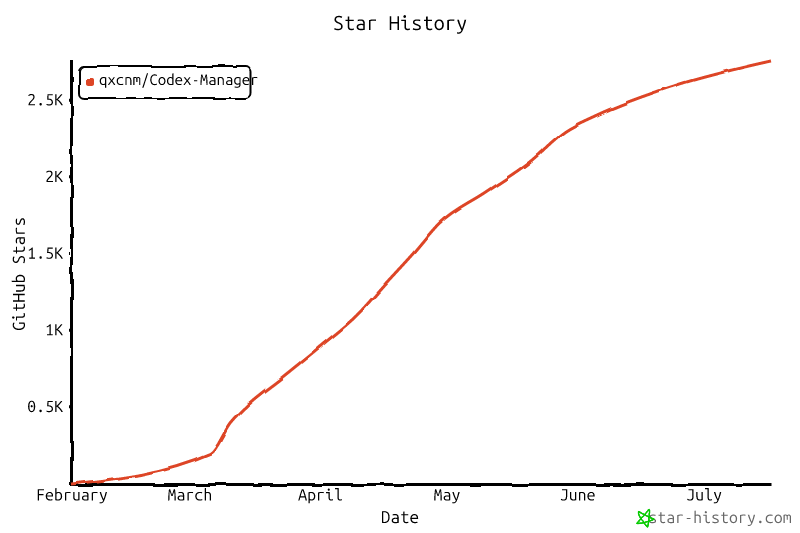
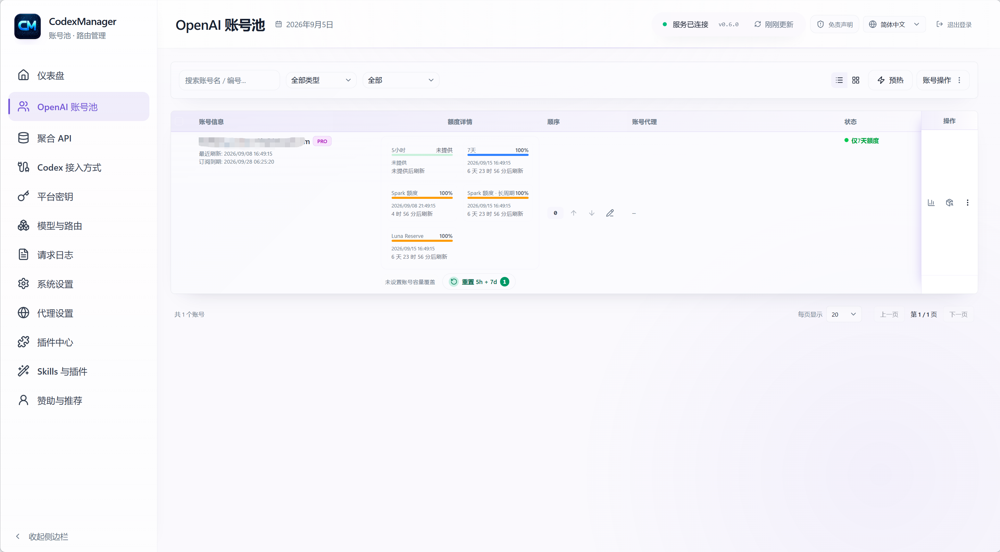
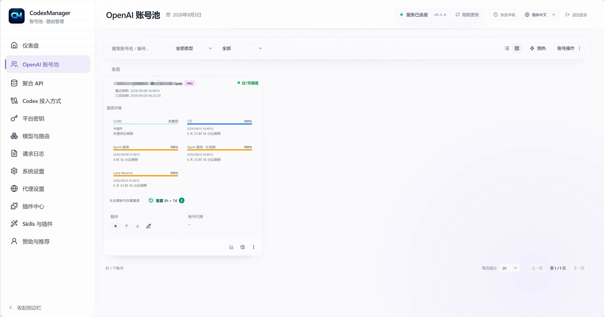
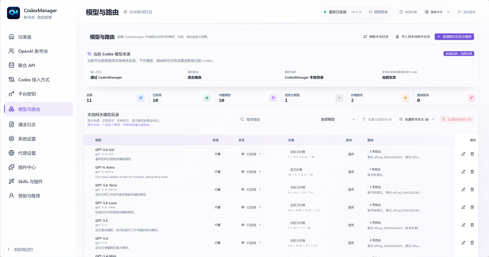
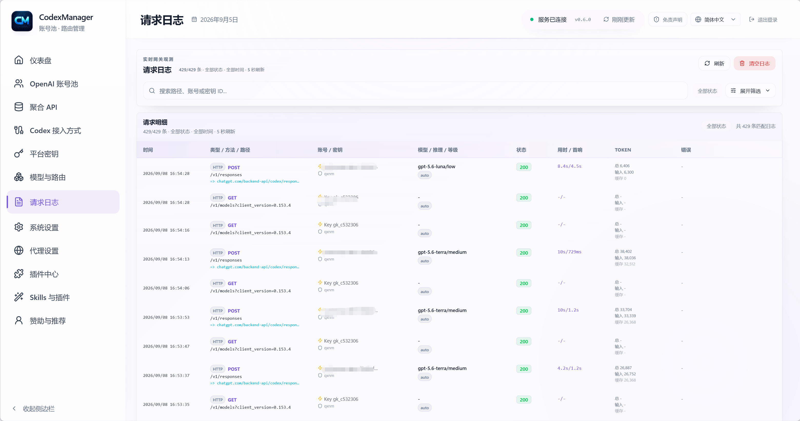
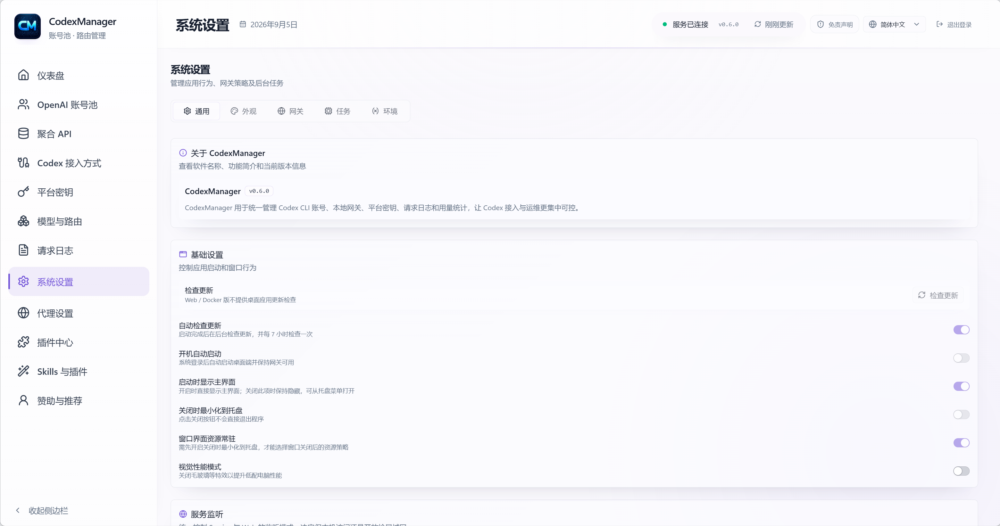

# CodexManager

<table align="center">
  <tr>
    <td align="center" valign="middle" width="44%">
      
      <br />
      <sub>
        <a href="https://qxnm.top/">Сайт</a> ·
        <a href="#спонсоры">Спонсоры</a>
      </sub>
    </td>
    <td align="center" valign="middle" width="13%">
      <sub>
        <a href="../../README.md">English</a>
        <br />
        <a href="../zh-CN/README.md">中文</a>
        <br />
        <strong>Русский</strong>
        <br />
        <a href="../ko/README.md">한국어</a>
      </sub>
    </td>
    <td align="center" valign="middle" width="23%">
      <a href="https://github.com/qxcnm/Codex-Manager">
        
      </a>
      <br />
      <a href="https://atomgit.com/qxnm/Codex-Manager">
        
      </a>
      <br />
      <a href="https://gitee.com/hongshungao/Codex-Manager">
        
      </a>
    </td>
    <td align="center" valign="middle" width="20%">
      <sub><strong>Сообщество</strong></sub>&nbsp;
      <a href="https://linux.do/t/topic/1688401" title="LINUX DO">
        
      </a>
      &nbsp;
      <a href="https://xuanwu.openatom.org/articles/project/codex-manager/" title="Сообщество Xuanwu">
        
      </a>
    </td>
  </tr>
</table>

CodexManager — локальный менеджер пула аккаунтов Codex с настольным приложением и сервисной версией. Он объединяет управление аккаунтами, отслеживание лимитов и OpenAI-совместимый шлюз для инструментов разработки с AI.

При новой установке по умолчанию включено **автоопределение языка**: приложение использует язык, сообщаемый WebView настольного приложения или браузером. Поддерживаются китайский, английский, русский и корейский; если язык не поддерживается или сведения о нём недоступны, используется **английский**. Язык можно выбрать вручную в верхнем меню или настройках; сохранённый выбор сохраняется.

**CodexManager присоединился к [сообществу Xuanwu](https://xuanwu.openatom.org/articles/project/codex-manager/)** — техническому Rust-сообществу, которое развивается при поддержке OpenAtom Foundation.

<table>
  <tr>
    <td valign="top" width="50%">
      <strong>Примечание об исходном коде</strong>
      <br />
      <sub>
        Этот продукт создан под моим руководством с помощью AI: Codex (98%) и Gemini (2%). Если вы столкнулись с проблемой, пожалуйста, общайтесь уважительно. У меня нет всех сред для проверки каждого пакета, поэтому я могу гарантировать работу только Windows desktop-версии. Для других платформ тщательно проверяйте проблему перед созданием Issue. Спасибо всем, кто сообщает о проблемах и помогает с тестированием.
      </sub>
    </td>
    <td valign="top" width="50%">
      <strong>Отказ от ответственности</strong>
      <br />
      <sub>
        Проект предназначен исключительно для обучения и разработки; пользователи обязаны соблюдать условия соответствующих платформ, включая OpenAI и Anthropic; автор не предоставляет и не распространяет аккаунты, API key или proxy-сервисы и не несёт ответственности за конкретные способы использования программы; не используйте проект для обхода ограничений скорости или сервиса.
      </sub>
    </td>
  </tr>
</table>

## Спонсоры

Проект открыт для спонсорского сотрудничества, стоимость обсуждается. Спонсоры могут разместить в README и внутри проекта логотип бренда, описание и официальную ссылку. Текст, позиция, срок показа и дата публикации согласовываются сторонами. Партнёрские материалы должны быть связаны с экосистемой разработчиков или AI-инструментов и соответствовать законодательству.

**Связь по сотрудничеству:** WeChat, Telegram или электронная почта `18272669457@163.com`; при добавлении в WeChat укажите «Спонсорство».

Благодарим друзей и партнёров за поддержку CodexManager.

[](https://pateway.ai/?ch=kimnmd)

Благодарим <strong>PatewayAI</strong> за спонсорскую поддержку проекта!

PatewayAI специализируется на высококачественном официальном API relay для моделей, полностью поддерживает серии Claude и Codex, предоставляет прозрачный биллинг и корпоративный сервис.

Экономичный режим — от 5% стандартной цены. Зарегистрируйтесь по <a href="https://pateway.ai/?ch=kimnmd" rel="sponsored nofollow">этой ссылке</a>, чтобы получить пробный баланс, участвовать в акциях с бесплатными кредитами и получить до 150 долларов по двусторонней реферальной программе.

---

<table>
  <tr>
    <td align="center" valign="middle" width="180">
      <a href="https://sidrune.ai/register?source=github&campaign=codexmanger&promo=codexmanger"></a>
    </td>
    <td valign="top">
      <strong><a href="https://sidrune.ai/register?source=github&campaign=codexmanger&promo=codexmanger">Sidrune AI — единая точка доступа к ведущим AI-моделям мира и управления ими</a></strong><br />
      Sidrune AI предоставляет индивидуальным разработчикам, техническим командам и предприятиям единый API для доступа к ведущим AI-моделям и управления ими. Динамическое распределение между несколькими маршрутами повышает доступность; качество моделей, время ответа и расходы доступны для прозрачного сравнения. В зависимости от модели и маршрута стоимость API-запросов может быть на 40–98% ниже официальной или базовой цены.<br />
      <a href="https://sidrune.ai/register?source=github&campaign=codexmanger&promo=codexmanger">Зарегистрируйтесь сейчас</a>, чтобы получить пробный баланс 3,88 доллара, готовый к использованию.
    </td>
  </tr>
  <tr>
    <td align="center" valign="middle" width="180">
      <a href="https://onesay.io"></a>
    </td>
    <td valign="top">
      <strong><a href="https://onesay.io">Лучшая альтернатива Typeless: OneSay Pro бесплатно на 3 месяца!</a></strong><br />
      Устали от медленного набора текста и низкой производительности? Попробуйте OneSay Desktop — голосового AI-помощника с умной диктовкой, AI-переводом, переработкой текста и ответами на вопросы. Пишите письма, отвечайте на сообщения и записывайте идеи голосом.<br />
      <strong>Ограниченное предложение: новым пользователям — 3 месяца режима Pro бесплатно!</strong> Приглашайте друзей зарегистрироваться, чтобы продлить подписку: чем больше приглашений, тем дольше бесплатное использование.<br />
      Попробуйте эффективность голосового ввода уровня Typeless с OneSay. Регистрация: <a href="https://onesay.io">https://onesay.io</a>
    </td>
  </tr>
  <tr>
    <td align="center" valign="middle" width="180">
      <a href="https://omniakey.com"></a>
    </td>
    <td valign="top">
      <strong>Привет! Рады, что вы нас заметили 👋</strong><br />
      Мы — команда <strong><a href="https://omniakey.com">OmniaKey</a></strong>, мультимодальная платформа AI API relay для разработчиков. Один API key открывает доступ к моделям для текста, изображений, видео и аудио.<br />
      <strong>📝 Текст:</strong> GPT, Claude, Gemini, Grok, GLM, Qwen и другие ведущие модели для диалогов, кода и рассуждений.<br />
      <strong>🎨 Изображения:</strong> GPT-image-2.5, Nanobanna 2.1, Seedream 5.0 Pro — готовые возможности генерации по тексту, преобразования и редактирования изображений.<br />
      <strong>🎬 Видео:</strong> Seedance 2.5, Wan3, Kling, MiniMaxH3 — генерация видео по тексту и изображениям через простое подключение.<br />
      <strong>🔊 Аудио:</strong> генерация музыки Suno AI через прямые API-вызовы для ваших аудиопроектов.<br />
      Сайт: <a href="https://omniakey.com">omniakey.com</a> · Китайская версия: <a href="https://omniakey.com/zh">omniakey.com/zh</a>
    </td>
  </tr>
  <tr>
    <td align="center" valign="middle" width="180">
      <a href="https://daitouai.com/"></a>
    </td>
    <td valign="top">
      <strong><a href="https://daitouai.com/">Daitou AI (呆头 AI)</a></strong> специализируется на API ведущих китайских больших моделей и упрощает подключение GLM, Kimi, DeepSeek и других моделей для диалогов, генерации кода, создания контента и автоматизации разработки. Платформа предлагает цены ниже официальных, быстрый пробный доступ для индивидуальных разработчиков и использование по потребности для независимых проектов и команд, помогая снизить расходы на китайские модели. Доступные модели, способы подключения и текущие предложения опубликованы на <a href="https://daitouai.com/">официальном сайте</a>.
    </td>
  </tr>
  <tr>
    <td align="center" valign="middle" width="180">
      <a href="https://api.fenno.ai/s/4ADZ"></a>
    </td>
    <td valign="top">
      <strong><a href="https://api.fenno.ai/s/4ADZ">FennoAI</a></strong> предоставляет стабильный высокопроизводительный API relay для корпоративных R&amp;D-команд и разработчиков, совместимый с протоколами OpenAI и Anthropic и инструментами Codex, Claude Code и OpenCode. Инфраструктура корпоративного уровня рассчитана на сотни миллиардов токенов в день и поддерживает расчёты между юридическими лицами в Китае и за рубежом, а также выставление счетов. При покупке подписки по <a href="https://api.fenno.ai/s/4ADZ">специальной ссылке</a> пользователи Codex-Manager получают Coding Plan с балансом 50 долларов за 1,99 доллара; комиссия за покупки приглашённых друзей — до 20%: больше приглашений — больше вознаграждений.
    </td>
  </tr>
  <tr>
    <td align="center" valign="middle" width="180">
      <a href="https://s.qiniu.com/eiaQrq"></a>
    </td>
    <td valign="top">
      <strong><a href="https://s.qiniu.com/eiaQrq">Qiniu Cloud AI</a></strong> — корпоративная MaaS-платформа Qiniu Cloud (02567.HK) с единым доступом к более чем 150 ведущим мировым моделям и совместимостью с протоколами основных поставщиков. Она поддерживает текст, изображения, аудио, видео и обработку файлов и обслуживает более 1,69 млн предприятий и разработчиков. При регистрации по <a href="https://s.qiniu.com/eiaQrq">специальной ссылке</a> корпоративные пользователи Codex-Manager бесплатно получают 12 млн токенов, разработчики — 3 млн.
    </td>
  </tr>
  <tr>
    <td align="center" valign="middle" width="180">
      <a href="https://www.aixiamo.com/?utm_source=github&utm_medium=sponsor&utm_campaign=codex_manager&utm_content=logo_brand_home_v3"></a>
    </td>
    <td valign="top">
      <strong><a href="https://www.aixiamo.com/?utm_source=github&utm_medium=sponsor&utm_campaign=codex_manager&utm_content=brand_home_v3">Официальный сайт AIXiamo | Пополнение ChatGPT Plus / Pro для собственного аккаунта в Китае</a></strong><br />
      <strong>Не хватает лимита Codex — Plus или Pro?</strong> Для обычной работы выберите <a href="https://www.aixiamo.com/chatgpt-plus-domestic-recharge?utm_source=github&utm_medium=sponsor&utm_campaign=codex_manager&utm_content=plus_owner_v3">Plus</a>; при частых лимитах и длительных задачах сравните <a href="https://www.aixiamo.com/chatgpt-pro?utm_source=github&utm_medium=sponsor&utm_campaign=codex_manager&utm_content=pro_owner_v3">Pro 5x / 20x</a>.<br />
      <strong>Руководство спонсора:</strong> <a rel="sponsored nofollow" href="https://gpt-guide.aixiamo.com/knowledge">выбор и пополнение ChatGPT Plus / Pro в Китае в 2026 году</a><br />
      Поддерживается Alipay без зарубежной карты; сервис не запрашивает пароли, коды подтверждения или восстановления. Заказы отслеживаются, доступна поддержка на китайском; если пополнение не удалось, после проверки возвращается вся сумма. Сервис работает более трёх лет и обслужил десятки тысяч пользователей онлайн и офлайн. Также доступны Claude Pro / Max, Gemini (Google AI Pro), Grok / SuperGrok и другие подписки.<br />
      Доступны корпоративные закупки и <a href="https://www.aixiamo.com/articles/aixiamo-invoice-application-notice-2026?utm_source=github&utm_medium=sponsor&utm_campaign=codex_manager&utm_content=invoice_notice_v3">выставление счетов для завершённых заказов после согласования с поддержкой</a>.
    </td>
  </tr>
  <tr>
    <td align="center" valign="middle" width="180">
      <a href="https://gzxsy.vip/register?aff=eapz"></a>
    </td>
    <td valign="top">
      <strong>Xing Si Yan Gateway</strong> предоставляет стабильный relay и сопутствующие услуги для Claude Code, Codex и аналогичных сценариев. Подходит разработчикам и командам, которым нужны доступный API, простое подключение и постоянная поддержка. Актуальные предложения доступны на <a href="https://gzxsy.vip/register?aff=eapz">официальном сайте</a>.
    </td>
  </tr>
</table>

Другие участники поддержки: 呆头呆脑, [Wonderdch](https://github.com/Wonderdch), [suxinwl](https://github.com/suxinwl), [Hermit](https://github.com/HermitChen), [Suifeng023](https://github.com/Suifeng023), [HK-hub](https://github.com/HK-hub)

## ☕ Поддержать проект

Если проект оказался полезен, вы можете поддержать автора!

<table>
  <tr>
    <th>Alipay</th>
    <th>WeChat Pay</th>
  </tr>
  <tr>
    <td align="center"></td>
    <td align="center"></td>
  </tr>
</table>

## История звёзд

<a href="https://www.star-history.com/?repos=qxcnm%2FCodex-Manager&type=date&legend=top-left">
 <picture>
   <source media="(prefers-color-scheme: dark)" srcset="../../assets/images/star-history-dark.png" />
   <source media="(prefers-color-scheme: light)" srcset="../../assets/images/star-history-light.png" />
   
 </picture>
</a>

## Навигация по главной странице

| Что нужно сделать | Открыть документ |
| --- | --- |
| Первый запуск, развёртывание, Docker, разрешение macOS | [Руководство по запуску и развёртыванию](report/Руководство-по-запуску-и-развертыванию.md) |
| Настройка Codex CLI / ccswitch, `auth.json` и `config.toml` | [Руководство по запуску и развёртыванию](report/Руководство-по-запуску-и-развертыванию.md#подключение-через-ccswitch) |
| Импорт аккаунта через ChatGPT `/api/auth/session` без входа через Codex | [Китайское руководство по импорту ChatGPT session](../zh-CN/report/不登陆Codex使用ChatGPT-auth-session导入账号.md) |
| Порты, proxy, база данных, Web-пароль и переменные среды | [Переменные среды и конфигурация запуска](report/Переменные-среды-и-конфигурация-запуска.md) |
| Маршрутизация аккаунтов, ошибки импорта, challenge и запросы | [FAQ и правила маршрутизации аккаунтов](report/FAQ-и-правила-маршрутизации-аккаунтов.md) |
| Почему фоновые задачи пропускают или отключают аккаунты | [Пропуск аккаунтов фоновыми задачами](report/Пропуск-аккаунтов-фоновыми-задачами.md) |
| Модели, цены, маршруты, instructions policy и применение каталога моделей к Codex | [Китайское руководство по Model Catalog V2](../zh-CN/report/模型目录V2管理与计费说明.md) |
| Минимальная интеграция центра плагинов | [Минимальная интеграция центра плагинов](report/Минимальная-интеграция-центра-плагинов.md) |
| Интерфейсы, режимы marketplace и Rhai API | [Интеграция центра плагинов и интерфейсы](report/Интеграция-центра-плагинов-и-интерфейсы.md) |
| Все внутренние интерфейсы системы | [Сводка внутренних интерфейсов](report/Сводка-внутренних-интерфейсов-системы.md) |
| Сборка, упаковка, выпуск и скрипты | [Сборка, выпуск и скрипты](release/Сборка-выпуск-и-скрипты.md) |

## Обзор возможностей

- Управление пулом аккаунтов: группы, теги, порядок, заметки, обнаружение блокировок и фильтрация.
- Пакетный импорт и экспорт: несколько файлов, рекурсивный импорт JSON-папки на desktop и отдельный файл для каждого аккаунта.
- Использование: стандартные окна 5 часов + 7 дней, аккаунты только с 7-дневным окном и дополнительные лимиты Code Review / Spark с процентами остатка и временем сброса.
- [Автоматическое пробуждение после сброса лимита (на китайском)](../zh-CN/额度重置自动唤醒.md): по умолчанию после наступления времени сброса исчерпанного 5-часового лимита отправляется короткое сообщение для прогрева. Функцию можно включать и отключать для отдельных аккаунтов или пакетно, сокращая ожидание следующего обновления квоты.
- Авторизация: browser OAuth на `chatgpt.com` и Device Code; callback URL можно вставить вручную.
- Platform Key: случайная генерация или собственное фиксированное значение, отключение, удаление, привязка модели, уровня рассуждений и уровня сервиса (из запроса / Standard / Fast / Ultrafast / Flex). Можно ограничить ключ пользовательскими группами аккаунтов; их пересечение с фильтром тарифного плана определяет разрешённый пул для ротации.
- Модели: Model Catalog V2 — единственный источник конфигурации во время выполнения; builtin/custom, три целочисленные цены и ступенчатые тарифы для длинного контекста, маршруты пула аккаунтов / агрегации API, instructions policy, локальные JSON preview/commit и применение выбранных моделей к `model_catalog_json` в Codex.
- Текущий builtin-каталог содержит 12 записей. `gpt-6.1-sol`, `gpt-6-astra`, `gpt-6-sol`, `gpt-6-luna`, три модели GPT-5.6, `gpt-5.5`, `gpt-image-2` и два варианта Image 2.5 составляют 11 моделей, видимых по умолчанию; скрыт только `codex-auto-review`.
- `gpt-5.4` и `gpt-5.4-mini` выведены из Codex со входом через ChatGPT 31 августа 2026 года, а `gpt-5.2` помечена deprecated именно для этого способа входа; общая API-модель этой очисткой не удаляется. Revision 9 удаляет их неизменённые builtin-записи, но пользовательские правки, price tiers, нестандартные routes и связи permission/API key сохраняются после перевода модели в custom. Пользователи API key также могут явно добавить custom-модель с тем же slug.
- Агрегация API: управление сторонними upstream с минимальной пересылкой запросов, создание, изменение, просмотр баланса и проверка подключения по настроенным маршрутам V2. Автоматического обнаружения моделей поставщика нет: администратор может запросить их и выборочно связать с Model Catalog V2; прежний пул моделей поставщиков не поддерживается.
- Центр плагинов: `/plugins/`, встроенный, корпоративный и пользовательский marketplace, манифесты, задачи, логи и Rhai.
- Skills и плагины: `/skills/` разделяет установку Skills и плагинов Codex. Для Skills доступны встроенные и пользовательские GitHub-репозитории, обновление репозитория и установка отдельных Skills, поиск и установка через skills.sh, импорт ZIP/каталогов и управление установленными Skills. Установка плагинов Codex сохраняет полный процесс через нативный Marketplace; встроенные Skills из `.system` всегда доступны только для чтения.
- Запуск проектов: desktop сохраняет локальные каталоги; Windows/macOS открывают workspace в ChatGPT Codex App, а «Сессии» запускают `resume` в новом терминале с локальным профилем.
- Настройки: кнопка определения значений по системе, лимит параллельных запросов на аккаунт, upstream proxy, общий тайм-аут запроса и тайм-аут простоя потока, переключатель и интервал SSE keepalive, а также более консервативное снижение нагрузки при высокой параллельности. SSE keepalive включён по умолчанию и отключается через `CODEXMANAGER_SSE_KEEPALIVE_ENABLED=0` или `false`; экспериментальный upstream WebSocket выключен по умолчанию и включается через `CODEXMANAGER_USE_WEBSOCKET_UPSTREAM=1`.
- Реестр внутренних интерфейсов: desktop/service-команды, RPC и встроенные функции плагинов.
- Локальный сервис: автоматический запуск, настраиваемые порт и адрес.
- Локальный шлюз: единый OpenAI-совместимый endpoint для Codex CLI, Gemini CLI, Claude Code и сторонних инструментов; Gemini → `/v1/responses`, SSE, tools, MCP, skills и timeout.
- Генерация изображений: автоматическая вставка инструмента `image_generation` для `/v1/responses` в соответствии с поведением официального Codex, передача явно заданного инструмента и совместимые endpoints `/v1/images/generations` и `/v1/images/edits`. Основная модель совместимого Images API по умолчанию — `gpt-6-luna`, модель инструмента изображений по умолчанию остаётся `gpt-image-2`; два варианта Image 2.5 можно выбрать явно.

## Скриншоты














## Быстрый старт

1. Скачайте пакет для своей платформы из [GitHub Releases](https://github.com/qxcnm/Codex-Manager/releases/latest), запустите desktop-приложение и нажмите **Запустить сервис**.
2. В разделе **Аккаунты** выберите browser authorization или Device Code для входа на `chatgpt.com`.
3. Если callback не сработал, вставьте его URL вручную.
4. Обновите данные об использовании и проверьте состояние аккаунта.

## Каталог данных по умолчанию

- SQLite-база desktop-приложения хранится в каталоге данных приложения под именем `codexmanager.db`.
- Windows: `%APPDATA%\\com.codexmanager.desktop\\codexmanager.db`
- macOS: `~/Library/Application Support/com.codexmanager.desktop/codexmanager.db`
- Linux: `~/.local/share/com.codexmanager.desktop/codexmanager.db`
- Перед первой инициализацией после обновления рядом сохраняется `codexmanager.db.pre-<версия>.bak`; повторная попытка той же версии не перезаписывает его.
- Раздел «Диагностика desktop» позволяет включить режим Debug, отключить обычный файловый лог и открыть каталог логов. Обычный лог ограничен 512 КБ и автоматически перезаписывается; журнал запросов и статистика токенов/стоимости не затрагиваются.
- Если UI не запускается, используйте `CodexManager.exe --debug` (на macOS/Linux — `CodexManager --debug`) для временного включения подробных логов. Причина ошибки запуска показывается в окне и записывается в `startup-error.log` в указанном в этом окне каталоге логов.
- Настройки базы, proxy и адреса описаны в [конфигурации запуска](report/Переменные-среды-и-конфигурация-запуска.md).
- Service-версия также поддерживает MySQL/PostgreSQL через SeaORM при сборке с соответствующим драйвером. Старую SQLite-базу можно экспортировать в режиме только для чтения и транзакционно импортировать в пустую целевую базу; см. [переключение базы и офлайн-импорт (на китайском)](../zh-CN/report/环境变量与运行配置说明.md#service-数据库切换与离线导入). Проверки на изолированных локальных базах не подтверждают готовность production-развёртывания; текущий охват описан в [отчёте о проверке миграции (на китайском)](../zh-CN/report/Axum-Tokio-Tower-SeaORM迁移进度与会话交接.md).
- Docker использует `TZ=Asia/Shanghai`; Compose наследует `TZ` окружения или применяет этот fallback. Для другого региона задайте подходящий IANA timezone.

## Интерфейс

### Desktop

- Аккаунты: импорт, экспорт, обновление аккаунтов и лимитов, фильтры низкой квоты/блокировки и время сброса.
- Platform Key: привязка по модели, reasoning tier и service tier, просмотр журнала запросов.
- Подключение Codex: прямое подключение аккаунта OpenAI, прямое подключение агрегированного API, который можно безопасно сопоставить с Responses, и подключение через локальный шлюз CodexManager. Подключение аккаунта записывает `auth.json` для переключения аккаунтов. Прямое подключение агрегированного API и шлюз сохраняют `auth.json` и обновляют только `config.toml`; `experimental_bearer_token` провайдера содержит выбранный ключ агрегированного API при прямом подключении или ключ платформы CodexManager при подключении через шлюз. Прямое подключение агрегированного API не проходит через локальный шлюз и не попадает в его журнал запросов.
- Модели: desktop и Web не записывают и не загружают `~/.codex/models_cache.json`; direct accounts используют официальный каталог, локальный gateway — отдельный управляемый каталог.
- Локальный gateway поддерживает существующую авторизацию ChatGPT или API key (`auth_mode = "chatgpt"` или `"apikey"`) без требования определённого способа входа. Настройка gateway обновляет только `config.toml`, сохраняет существующий `auth.json` байт в байт, не создаёт файл авторизации и не требует токены входа ChatGPT. Provider `cm` использует `name = "cm"`, `requires_openai_auth = true` и platform key в `experimental_bearer_token`.
- Плагины: `/plugins/`, режимы marketplace, установка, включение, задачи, логи и Rhai.
- Skills и плагины: `/skills/`, отдельные вкладки, GitHub/skills.sh, импорт ZIP/каталога, безопасное удаление, Marketplace и read-only системные Skills.
- Проекты: локальные каталоги открываются в ChatGPT Codex App на Windows/macOS; «Сессии» используют локальный CLI; Web/Docker не получают доступ к каталогам устройства.
- Настройки: порт, адрес, proxy, timeout, SSE keepalive, тема, обновления и фоновое поведение.

### Service-версия

- `codexmanager-service`: локальный OpenAI-совместимый шлюз.
- `codexmanager-web`: Web-интерфейс и proxy `/api/runtime`, `/api/rpc`.
- `codexmanager-start`: совместный запуск service + web.

## Основные документы

- История версий: [Журнал изменений](Журнал-изменений.md)
- Участие: [Руководство для участников](Руководство-для-участников.md)
- Архитектура: [Архитектура](Архитектура.md)
- Тестирование: [Тестирование](Тестирование.md)
- Безопасность: [Безопасность](Безопасность.md)
- Model Catalog V2: [китайское руководство](../zh-CN/report/模型目录V2管理与计费说明.md)
- Индекс документации: [китайский индекс документации](../zh-CN/README.md#文档首页)

## Тематические страницы

| Страница | Содержание |
| --- | --- |
| [Запуск и развёртывание](report/Руководство-по-запуску-и-развертыванию.md) | Первый запуск, Docker, Service и macOS |
| [Переменные среды и конфигурация](report/Переменные-среды-и-конфигурация-запуска.md) | Настройки, proxy, адрес, база и Web-безопасность |
| [FAQ и маршрутизация аккаунтов](report/FAQ-и-правила-маршрутизации-аккаунтов.md) | Выбор аккаунта, challenge, импорт/экспорт и ошибки |
| [Китайское руководство по ChatGPT session](../zh-CN/report/不登陆Codex使用ChatGPT-auth-session导入账号.md) | Копирование session JSON и пакетный импорт |
| [Пропуск аккаунтов](report/Пропуск-аккаунтов-фоновыми-задачами.md) | Фильтры фоновых задач и причины отключения |
| [Минимальное устранение неполадок](report/Минимальное-руководство-по-устранению-неполадок.md) | Запуск сервиса, relay и обновление моделей |
| [Интеграция центра плагинов](report/Интеграция-центра-плагинов-и-интерфейсы.md) | Routes, marketplace, Tauri/RPC, manifest и Rhai |
| [Сборка, выпуск и скрипты](release/Сборка-выпуск-и-скрипты.md) | Локальная сборка, Tauri, workflow и параметры |
| [Выпуск и артефакты](release/Выпуск-и-артефакты.md) | Артефакты, имена и pre-release |
| [Матрица скриптов и релиза](report/Матрица-ответственности-скриптов-и-релиза.md) | Ответственность скриптов и сценарии |
| [Различия gateway и Codex](report/Различия-заголовков-и-параметров-шлюза-с-Codex.md) | Заголовки и параметры запросов |
| [Внутренние интерфейсы](report/Сводка-внутренних-интерфейсов-системы.md) | Desktop, service и plugin center |
| [Журнал изменений](Журнал-изменений.md) | Релизы, изменения до выпуска и история |

## Структура каталогов

```text
.
├─ apps/                # Frontend и Tauri desktop
│  ├─ src/
│  ├─ src-tauri/
│  └─ out/
├─ crates/              # Rust core/service
│  ├─ core
│  ├─ service
│  ├─ start              # Запуск service + web
│  └─ web                # Service Web UI и /api/rpc proxy
├─ docs/                # Официальная документация
├─ scripts/             # Скрипты сборки и выпуска
└─ README.md
```

## Благодарности и проекты-источники

- Codex (OpenAI): проект использует его подходы к цепочке запросов, авторизации и совместимости с upstream <https://github.com/openai/codex>
- CLIProxyAPI (CPA): проект использует его соглашения преобразования Responses-запросов и tool calls <https://github.com/router-for-me/CLIProxyAPI>

## Контакты

- Публичный аккаунт WeChat: 七线牛马
- WeChat: добавьте `ProsperGao`, чтобы вступить в группу, и укажите цель
- Telegram: [группа CodexManager](https://t.me/+OdpFa9GvjxhjMDhl)
